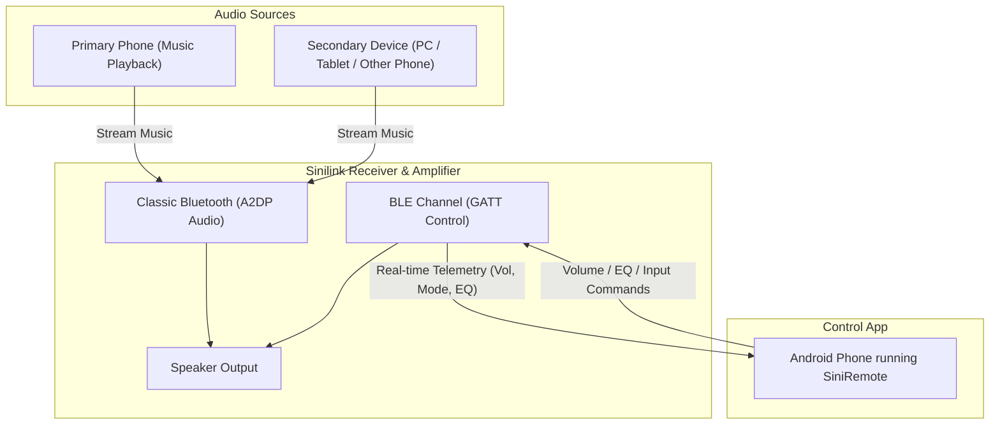

<p align="center">
  
</p>

<h1 align="center">SiniRemote</h1>

<p align="center">
  A Material 3 Expressive Android application designed to control Sinilink Bluetooth Audio Receivers and Amplifiers with persistent background connectivity, dynamic media themes, and tactile physics controls.
</p>

---

## Overview

SiniRemote allows you to control your Sinilink Bluetooth receiver (such as XY-AP15H, XY-C50H, XY-AP50H, etc.) directly from your Android device. It supports real-time volume adjustment, equalizer preset switching, input mode toggling, and background execution.

---

## How It Works (Connection Architecture)

Sinilink devices operate using **dual Bluetooth channels**. The audio stream and the control commands run independently:



- **Audio Channel (Classic BT / A2DP)**: Handles music playback. It can be connected to the same phone running SiniRemote, or to a completely separate device (e.g., PC, tablet, or another phone).
- **Control Channel (Bluetooth Low Energy / BLE GATT)**: Used by SiniRemote to send volume, EQ, and input source commands, and receive real-time amplifier state updates.

---

## Features

- **Persistent Background Connection**: Uses a foreground service to maintain the BLE link even when the app is minimized or swiped from Recents.
- **Dynamic Media Themes**: Extracts album art colors from active playback to dynamically theme the app UI.
- **Expressive Physics & Haptics**: Features adjacent button morphing animations and double-pulse tactile haptic feedback.
- **Equalizer Control**: Quick switching between Normal, Rock, Pop, Classic, Jazz, and Country presets with auto-apply on connect.
- **Input Selection**: Easily switch between Bluetooth, AUX, USB, TF Card, and PC Audio modes.
- **Volume Memory Mute**: Caches volume prior to muting and restores the exact previous level when unmuted.

---

## Screenshots

<p align="center">
  
  &nbsp;&nbsp;&nbsp;&nbsp;
  
  &nbsp;&nbsp;&nbsp;&nbsp;
  
</p>

---

## Installation

Download the compiled APK from the [Releases](https://github.com/kxrthikc/SiniRemote/releases) section.

1. Download `SiniRemote-v1.0.0.apk` onto your Android device.
2. Open the file to install (allow *"Install from Unknown Sources"* if prompted).
3. Grant **Bluetooth** and **Notification Access** permissions for full functionality.

---

## Building from Source

1. Clone this repository:
   ```bash
   git clone https://github.com/kxrthikc/SiniRemote.git
   ```
2. Open the project in **Android Studio**.
3. Build the debug APK via Terminal:
   ```bash
   ./gradlew assembleDebug
   ```
4. Output APK location: `app/build/outputs/apk/debug/app-debug.apk`

---

## Author & License

Developed by **[kxrthikc](https://github.com/kxrthikc)**.

Distributed under the [MIT License](LICENSE).
