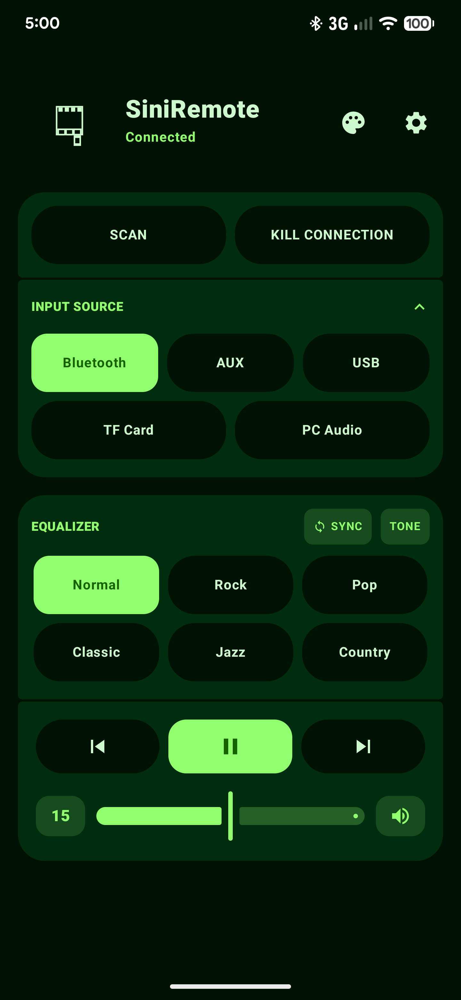
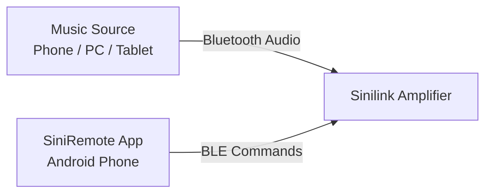
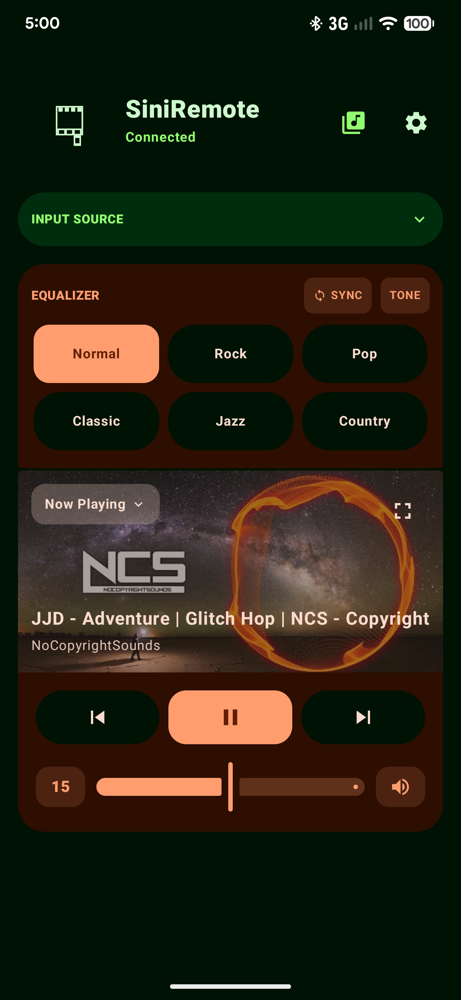
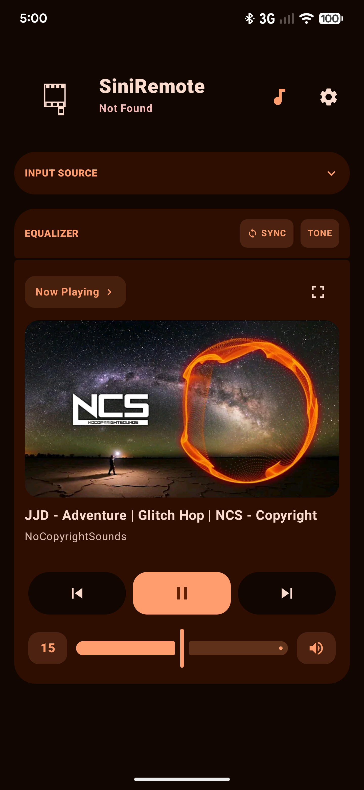
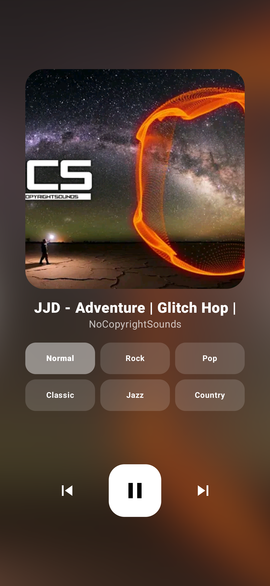
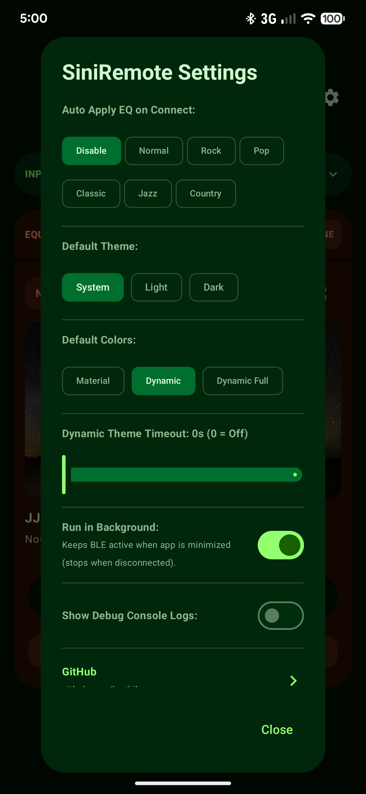

<p align="center">
  
</p>

# SiniRemote

**SiniRemote** is a Material 3 Expressive Android application designed to control Sinilink Bluetooth Audio Receivers and Amplifiers (XY-C50L, XY-AP15H, XY-C50H, XY-AP50H, etc.) (**Note: Only Tested for XY-C50L**) with persistent background connectivity, dynamic media themes, and tactile physics controls.

---

## Hero Overview

<p align="center">
  
</p>

---

## Connection Diagram

Sinilink devices use separate Bluetooth channels for audio streaming and app controls. You can play music from any device while controlling the amplifier with SiniRemote:



---

## Screenshots

| Main Controls | Now Playing Widget |
| :---: | :---: |
|  |  |

| Full Screen Player | Settings Dialog |
| :---: | :---: |
|  |  |

---

## Features

- **Persistent Background Connection**: Maintains the BLE link even when the app is minimized or swiped from Recents.
- **Dynamic Media Themes**: Extracts album art colors from active playback to dynamically theme the app UI.
- **Expressive Physics & Haptics**: Features adjacent button morphing animations and double-pulse tactile haptic feedback.
- **Equalizer Control**: Quick switching between Normal, Rock, Pop, Classic, Jazz, and Country presets with auto-apply on connect.
- **Input Selection**: Easily switch between Bluetooth, AUX, USB, TF Card, and PC Audio modes.
- **Volume Memory Mute**: Caches volume prior to muting and restores the exact previous level when unmuted.

---

## Installation

Download the compiled APK from the [Releases](https://github.com/kxrthikc/SiniRemote/releases) section.

1. Download `SiniRemote-v1.0.0.apk` onto your Android device.
2. Open the file to install (allow *"Install from Unknown Sources"* if prompted).
3. Grant **Bluetooth** and **Notification Access** permissions for full functionality.

---

## Building from Source

1. Clone this repository:
   ```bash
   git clone https://github.com/kxrthikc/SiniRemote.git
   ```
2. Open the project in **Android Studio**.
3. Build the debug APK via Terminal:
   ```bash
   ./gradlew assembleDebug
   ```
4. Output APK location: `app/build/outputs/apk/debug/app-debug.apk`

---

## Author & License

Developed by **[kxrthikc](https://github.com/kxrthikc)**.

Distributed under the [MIT License](LICENSE).
